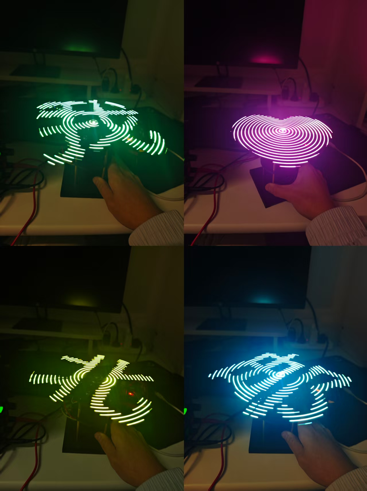

# 风扇全息显示屏
本工程基于STM32F407，实现了一种风扇全息显示屏。  
  
具体地，使用一根贴有数十个LED的直杆，直杆中心连一个电机；电机旋转时，LED会根据配置的图案快速切换。由于视觉暂留效应，用户可以观察到整个圆面上显示出完整的图案。  
配置显示图案的方式见[风扇全息显示屏图案生成](pattern_gen/README.md)。  

## 原理简介
大疆M2006电机编码器值范围为0~294911。  
将其分为`divide_num`份，每份对应一种LED灯带显示模式。  
在电机旋转时，根据当前编码器值，将LED灯带显示模式切换到对应的模式。  

## 视频演示
<video src="docs/demo.mp4" controls></video>  
